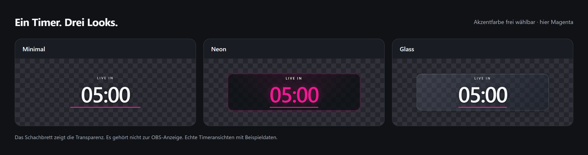
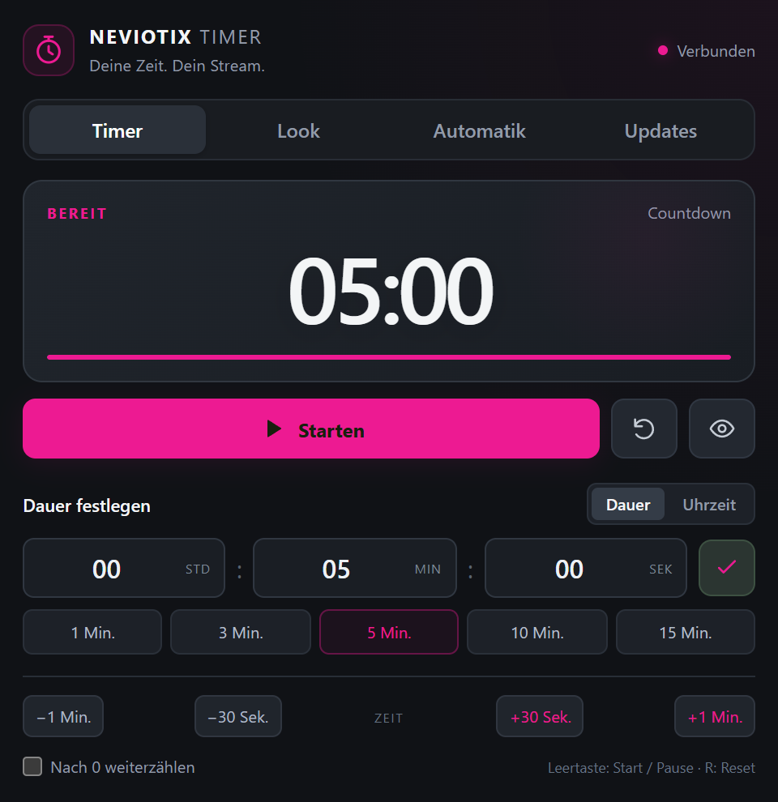
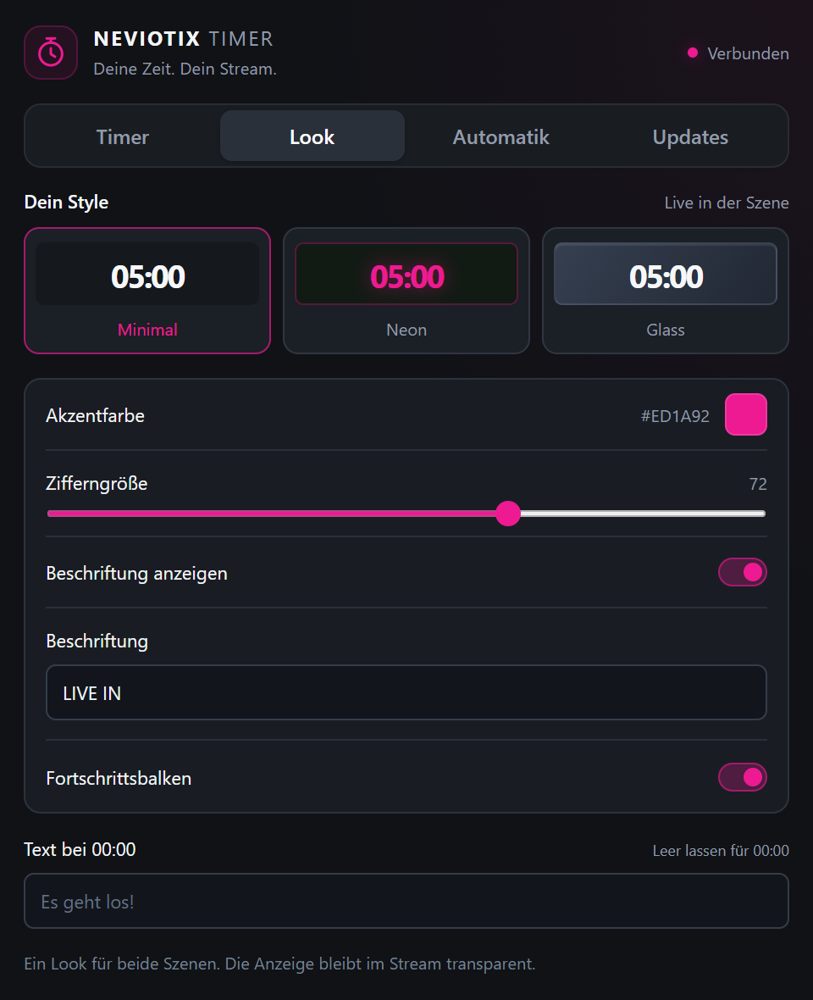

# NEVIOTIX Timer

**Deine Zeit. Dein Stream.** Ein Countdown für OBS, den du direkt im Dock bedienst und als transparente Anzeige in deine Szenen legst. Für Starting Soon, kurze Pausen und alles, was pünktlich losgehen soll.

**Windows · OBS Studio · Node.js 24+ · kostenlos unter MIT-Lizenz**

### [Windows-ZIP herunterladen](https://github.com/Nevio197/neviotix-timer/releases/latest) · [Installation](#installation-schritt-für-schritt) · [Hilfe](#wenn-etwas-nicht-klappt)



*Echte Timeransichten mit Beispieldaten. Das Schachbrett ist nur Vorschauhintergrund und erscheint nicht in OBS. Die Akzentfarbe kannst du selbst wählen.*

## Das bekommst du

- **Ein Dock zum Bedienen:** Dauer wählen, starten, pausieren oder spontan Zeit hinzufügen.
- **Transparente Anzeigen:** Starting Soon und BRB nutzen denselben Timerstand.
- **Drei Looks:** Minimal, Neon und Glass. Farbe, Beschriftung, Zifferngröße und Fortschrittsbalken sind anpassbar.
- **Flexible Zeit:** feste Dauer oder Countdown bis zu einer Uhrzeit; auf Wunsch nach 00:00 weiterzählen.
- **Optionale OBS-Hotkeys und Szenen-Automatik.** Ohne ausgewählte Automatik wechselt der Timer keine Szene.
- **Manuelle Updates:** direkt im Dock nach neuen GitHub-Releases suchen und sie per Klick installieren.

<table>
  <tr><th>Timer bedienen</th><th>Look anpassen</th></tr>
  <tr>
    <td valign="top"></td>
    <td valign="top"></td>
  </tr>
</table>

## Installation Schritt für Schritt

Du brauchst **Windows**, **[OBS Studio](https://obsproject.com/)** mit Browser-Quellen und **[Node.js 24 oder neuer](https://nodejs.org/)**. Falls Node.js noch fehlt: zuerst installieren. Du musst keinen Code bearbeiten und keine zusätzlichen npm-Pakete installieren.

### 1. Timer herunterladen und entpacken

Öffne die **[neueste Version](https://github.com/Nevio197/neviotix-timer/releases/latest)** und lade unter **Assets** die Datei **`NEVIOTIX-Timer-…-windows.zip`** herunter. Nimm das Windows-ZIP, nicht „Source code“.

1. Drücke **Windows + R**, gib `%LOCALAPPDATA%` ein und bestätige mit Enter.
2. Lege dort einen Ordner namens **`NEVIOTIX-Timer`** an.
3. Entpacke den **gesamten Inhalt** des ZIPs in diesen Ordner.

So muss die Ablage aussehen:

```text
%LOCALAPPDATA%\NEVIOTIX-Timer\
├── start.vbs
├── neviotix-timer.lua
├── server.cjs
├── package.json
├── public\
└── … weitere Dateien aus dem ZIP
```

`start.vbs` muss direkt im Timer-Ordner liegen. Starte den Timer nicht aus dem noch geöffneten ZIP.

### 2. Timer einmal starten

Klicke im Timer-Ordner doppelt auf **`start.vbs`**. Es erscheint absichtlich kein Terminalfenster.

Öffne zum Gegencheck diese Adresse im Browser:

```text
http://127.0.0.1:18771/
```

Wenn du das Timer-Dock siehst und oben **„Verbunden“** steht, läuft der Timer.

### 3. Automatischen Start mit OBS einrichten

1. Öffne in OBS **Werkzeuge → Skripte**.
2. Klicke auf **+** und wähle im Timer-Ordner **`neviotix-timer.lua`** aus.
3. Schließe das Skripte-Fenster.

Dadurch startet der Timer künftig beim Laden dieser OBS-Szenensammlung mit. Wenn das Skript schon in der Liste steht, musst du es nicht erneut hinzufügen. Für eine andere Szenensammlung fügst du es dort ebenfalls hinzu.

### 4. Bedien-Dock in OBS hinzufügen

1. Öffne **Docks → Benutzerdefinierte Browser-Docks**.
2. Trage diese Werte ein und klicke auf **Anwenden**:

| Feld | Eintrag |
| --- | --- |
| Dock-Name | `NEVIOTIX Timer` |
| URL | `http://127.0.0.1:18771/` |

Ziehe das neue Dock an die gewünschte Stelle in OBS. Hier bedienst du den Timer; diese Bedienoberfläche gehört nicht ins Streambild.

### 5. Countdown in deine Szene legen

1. Wähle deine Starting-Soon-Szene aus.
2. Klicke im Bereich **Quellen** auf **+ → Browser** und lege eine neue Quelle an.
3. Lass **„Lokale Datei“ ausgeschaltet** und trage Folgendes ein:

| Einstellung | Wert |
| --- | --- |
| URL | `http://127.0.0.1:18771/overlay/starting` |
| Breite | `600` |
| Höhe | `160` |

Bestätige mit **OK** und verschiebe die Anzeige in deiner Szene. Der Hintergrund ist transparent; du brauchst keinen Chroma-Key.

Für deine Pausenszene legst du eine weitere Browser-Quelle mit **600 × 160 Pixeln** an:

```text
http://127.0.0.1:18771/overlay/brb
```

Beim Standardlabel steht dort automatisch **„WIEDER DA IN“**. Beide Anzeigen zeigen dieselbe verbleibende Zeit.

### 6. Kurz ausprobieren

Wähle im Dock **1 Min.** und klicke auf **Starten**. Die Zeit muss im Dock und in deiner Szene herunterzählen. **Pausieren** hält sie an, **Zurücksetzen** stellt die gewählte Dauer wieder her.

Danach kannst du unter **Look** Farbe, Stil und Beschriftung einstellen. Fertig – für den normalen Countdown brauchst du keine weitere Verbindung oder Anmeldung.

## Alle Adressen auf einen Blick

| Wofür? | Adresse | In OBS hinzufügen als |
| --- | --- | --- |
| Timer bedienen | `http://127.0.0.1:18771/` | Benutzerdefiniertes Browser-Dock |
| Starting Soon | `http://127.0.0.1:18771/overlay/starting` | Browser-Quelle, 600 × 160 |
| Be Right Back | `http://127.0.0.1:18771/overlay/brb` | Browser-Quelle, 600 × 160 |

## Im Alltag

**Zeit einstellen:** Nutze die Schnellzeiten oder gib Stunden, Minuten und Sekunden ein und bestätige mit dem Haken. Mit **Uhrzeit** zählt der Timer bis zu einer gewählten Zielzeit.

**Zeit ändern:** Die Tasten **±30 Sek.** und **±1 Min.** funktionieren auch während des Countdowns. Das Augen-Symbol blendet die Anzeige im Stream aus oder wieder ein.

**Tastenkürzel:** Im fokussierten Dock startet oder pausiert die **Leertaste**, **R** setzt zurück. Beim Bearbeiten eines Eingabefelds bleiben diese Kürzel aus. Globale Tasten vergibst du unter **OBS → Einstellungen → Hotkeys → NEVIOTIX Timer**; es sind keine festen Tasten vorbelegt.

**Szenen-Automatik:** Unter **Automatik** kannst du optional beim Öffnen einer Szene starten oder bei 00:00 in eine andere Szene wechseln. Dafür muss der lokale OBS-WebSocket-Server aktiviert sein. Der reine Countdown funktioniert auch ohne diese Verbindung.

## Wenn etwas nicht klappt

| Problem | Das hilft |
| --- | --- |
| `start.vbs` zeigt kein Fenster. | Das ist beabsichtigt. Öffne `http://127.0.0.1:18771/`, um den Start zu prüfen. |
| Die Seite lädt nicht oder das Dock bleibt offline. | Prüfe, ob Node.js 24+ installiert ist und alle ZIP-Dateien vollständig entpackt sind. Starte danach `start.vbs` erneut. Details stehen in `%APPDATA%\NEVIOTIX-Timer\launcher.log`. |
| Nach dem nächsten OBS-Start fehlt der Timer. | Prüfe unter **Werkzeuge → Skripte**, ob `neviotix-timer.lua` in der aktuell geladenen Szenensammlung eingetragen ist. |
| Statt der Ziffern sehe ich die ganze Bedienoberfläche im Stream. | Die Quelle verwendet die Dock-URL. Trage dort `/overlay/starting` oder `/overlay/brb` ein. |
| Die Anzeige ist leer. | Blende sie über das Augen-Symbol im Dock ein. Prüfe dann die Quellen-URL und die Größe 600 × 160. |
| „OBS nicht verbunden“ steht unter Automatik. | Das betrifft die optionale Szenen-Automatik. Timer und Anzeige bleiben nutzbar; prüfe für automatische Szenenwechsel den lokalen OBS-WebSocket-Server. |
| Ich sehe kein Glas- oder Neon-Design. | Wähle unter **Look** das gewünschte Design. Die Screenshots oben zeigen Magenta als frei gewähltes Beispiel; die Standardfarbe kann abweichen. |

Noch ein Problem? **[Issue öffnen](https://github.com/Nevio197/neviotix-timer/issues)** und Windows-, OBS- und Timer-Version sowie die genaue Fehlermeldung angeben. Zugangsdaten und persönliche Konfigurationsdateien gehören nicht in den Bericht.

## Updates und lokale Daten

Im Tab **Updates** auf **Nach Updates suchen** klicken. Eine verfügbare stabile Version lässt sich mit **Update installieren** übernehmen. Der Dienst startet dabei kurz neu; der Countdown wird pausiert wiederhergestellt. Während eines aktiven Streams oder einer Aufnahme wird die Installation blockiert.

Das Update prüft Repository, Version, Archivpfade und SHA-256-Werte. Es sichert Installationsdateien und setzt einen fehlgeschlagenen Austausch zurück. Updates werden ausschließlich nach deinem Klick installiert.

- Der Timer läuft lokal auf **`127.0.0.1:18771`**, nicht im gesamten Netzwerk.
- Timer-Einstellungen liegen in **`%APPDATA%\NEVIOTIX-Timer\state.json`** und bleiben bei Updates erhalten.
- Die optionale Szenen-Automatik verwendet die bestehende lokale OBS-WebSocket-Konfiguration. Deren Zugangsdaten bleiben auf dem Rechner.
- Internet ist für Download und Update-Prüfung nötig; der Countdown selbst funktioniert offline.

## Entwicklung

Das Add-on besteht aus JavaScript, HTML, CSS und einem Lua-Skript. Es nutzt die Browser-Dock- und Skript-Funktionen von OBS und benötigt keine zusätzlichen npm-Pakete.

```text
npm run check
npm test
npm run package
```

Der Paketbau verwendet eine feste Dateiliste, sortierte ZIP-Einträge und einen festen Archiv-Zeitstempel. Er erzeugt unter `dist/` das Windows-ZIP, `update-manifest.json` und `SHA256SUMS`.

Für eine neue Version `package.json` und die sichtbare Version in der Dokumentation anpassen, prüfen und einen passenden `vX.Y.Z`-Tag veröffentlichen. Der Release-Workflow prüft den Tag gegen die Paketversion und veröffentlicht die drei Download-Dateien. Screenshots unter `docs/screenshots/` dienen der GitHub-Dokumentation und sind kein Bestandteil des Windows-Updatepakets.

<details>
<summary><strong>English quick start</strong></summary>

NEVIOTIX Timer is a local OBS countdown add-on with transparent overlays, an adjustable browser dock, three visual styles, optional scene automation, OBS hotkeys and manual GitHub updates.

1. Install **Windows OBS Studio** with browser sources and **Node.js 24+**.
2. Download the **Windows ZIP** from [Releases](https://github.com/Nevio197/neviotix-timer/releases/latest), not the source-code archive. Extract all files directly into `%LOCALAPPDATA%\NEVIOTIX-Timer`.
3. Run **`start.vbs`**. No terminal window appears. Visit `http://127.0.0.1:18771/` to check that the timer is running.
4. In OBS, open **Tools → Scripts → +** and add **`neviotix-timer.lua`** from that folder. This starts the service with the current scene collection.
5. Under **Docks → Custom Browser Docks**, add `NEVIOTIX Timer` with the URL `http://127.0.0.1:18771/`.
6. Add a **Browser** source to your scene. Leave **Local file** unchecked, set the URL to `http://127.0.0.1:18771/overlay/starting`, and use **600 × 160**. For a break scene, use `/overlay/brb` instead.
7. Choose a duration in the dock and press **Starten**. Use **Look** to customize the display.

The overlay background is transparent. The checkerboard in the screenshots is for preview only. Both overlays share one timer. No account or additional npm packages are required. OBS WebSocket is only needed for optional scene automation. The countdown works offline; downloads and update checks need internet.

</details>

## Lizenz

Veröffentlicht unter der [MIT-Lizenz](LICENSE).
